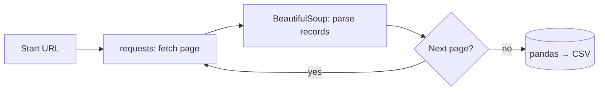

# 🕸️ BRIHA · Web Mining with Pagination


    

> ⚡ **Part of [BRIHA](https://github.com/asad110abbas)** · Briha Research, built by Syed Asad Abbas.

A complete **web-scraping pipeline** that walks through every page of a paginated website, extracts
structured records and saves them as a clean dataset ready for analysis.

## Pipeline


## Highlights
- **Automatic pagination:** follows "next" links or page numbers until the last page
- **Structured extraction** with BeautifulSoup selectors
- **Clean output** as a pandas DataFrame exported to CSV
- **Polite scraping** with request headers and delays

## Run
```bash
pip install requests beautifulsoup4 pandas
```
Open `Web_Mining.ipynb`, set the target URL and run all cells.

> Use responsibly and respect the website's terms of service.
